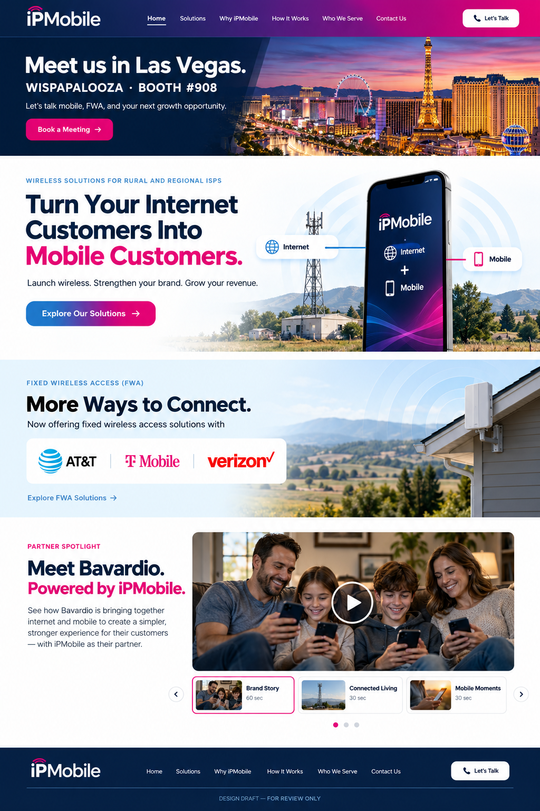

# iPMobile homepage review — Draft 01

Separate design concept for team approval. **This repository does not deploy to ipmobile.ai.**

## Review

- Proposed WISPAPALOOZA banner: Booth #908, Las Vegas.
- Booking link: https://calendar.app.google/sCq1uGNjbtY5FYhL6
- FWA announcement: AT&T, T-Mobile, Verizon.
- Three supplied Bavardio videos, selectable in rotation.

The homepage concept is a rendered design image, not the implemented production homepage. Artwork and carrier marks in it are illustrative. The review viewer provides real video controls and a working scheduler link.

Please add feedback under **Issues** with the section name and requested change. Final production changes require approval separately.

No custom domain or CNAME is configured here. Do not add ipmobile.ai as this repository's domain.
